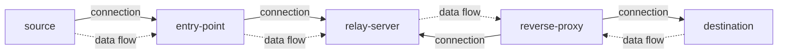

# tcp-reverse-proxy

A TCP TURN service with authentication, consists of three components: `entry-point`, `relay-server`, and `reverse-proxy`.

- `entry-point` is the main entry of the system. It listens on multiple ports and forwards all incoming data to the `relay-server`.

- The `relay-server` is responsible for forwarding the data received from the `entry-point` to the `reverse-proxy`.

- The `reverse-proxy` actively establishes a TCP connection to the `relay-server` to receive incoming requests from the source, and then forwards the data to the appropriate destination (dst) based on routing configuration.



## Build

- Cross-compile for all platforms

  ```sh
  make build
  ```

  Binary executables will be generated under the `build/os/arch` directory

- Build for the commonly used `linux/amd64` platform

  ```sh
  make build-linux-amd64
  ```

## Usage

1. Generate x509 cert and ed25519 key pair

   ```sh
   gen-cert x509 --dns localhost --ip 127.0.0.1,$YOUR_PUBLIC_IP
   gen-cert ed25519
   ```

   This step will generate x509 and ed25519 key pairs under the cert directory. The x509 key pair is used for establishing TLS connections, while the ed25519 key pair is used for authentication.

2. Start the `relay-server` on a server with public network access

   ```sh
   relay-server -p 4433
   ```

   The `relay-server` will automatically load certificates from the cert directory, listen on a local port, and wait for incoming connections from both the `entry-point` and the `reverse-proxy`.

3. Start the `reverse-proxy` on a server without public network access but that needs to be accessible from the outside

   ```sh
   reverse-proxy -s $YOUR_PUBLIC_IP:4433 -g 7
   ```

   Tell the `reverse-proxy` the address of the `relay-server`. It will actively open pending connections to get ready for incoming user requests.

   The `-g` option specifies the group ID, which defaults to `0`. A connection can only be established if the `reverse-proxy` and `entry-point` have matching group IDs.

4. Start the `entry-point` (usually on your local machine)

   ```sh
   entry-point -s $YOUR_PUBLIC_IP:4433 -r 5001:5001 -g 7
   ```

   Tell the `entry-point` the address of the `relay-server`. It will actively open pending connections for transmitting user requests. The `-r`(or `--routes`) parameter specifies the routing configuration. Multiple routing configurations are separated by commas. Supported formats are as follows:

   | Format          | Description                                                                                                                                    |
   | :-------------- | :--------------------------------------------------------------------------------------------------------------------------------------------- |
   | port:port       | Listen on a specified local port, accept connections from anywhere, and forward them to a specified port on remote `127.0.0.1`                 |
   | ip:port:port    | Bind to a specified local IP and port, and forward connections to a specified port on remote `127.0.0.1`      |
   | port:ip:port    | Listen on a specified local port, accept connections from any source, and forward them to a specified IP and port on the remote side           |
   | ip:port:ip:port | Bind to a specified local IP and port, and forward connections to a specified IP and port on the remote side. |

5. Send your request to the `entry-point`

## Run with Docker

- Generate x509 cert and ed25519 key pair through docker

  ```sh
  docker run --rm -v ./cert:/app/cert samlior0o0/entry-point ./gen-cert x509 --dns localhost --ip 127.0.0.1,$YOUR_PUBLIC_IP
  docker run --rm -v ./cert:/app/cert samlior0o0/entry-point ./gen-cert ed25519
  ```

- Start services

  > NOTE: when running with Docker, it is recommended to pass parameters through a configuration file

  ```sh
  docker run -v ./cert:/app/cert -v ./config:/app/config -p 4433:4433 samlior0o0/relay-server
  ```

  ```sh
  docker run -v ./cert:/app/cert -v ./config:/app/config --network host samlior0o0/reverse-proxy
  ```

  ```sh
  docker run -v ./cert:/app/cert -v ./config:/app/config --network host samlior0o0/entry-point
  ```

## Reliability and compatibility

- Each reverse-proxy relay connection owns its destination connection. Requests
  to the same destination are never paired through a shared destination queue.
- TCP/TLS framing is independent of individual reads: the challenge is 32 bytes,
  the authentication response is 65 bytes (legacy) or 66 bytes (with group ID),
  and the destination header is 18 bytes. Application data following a header is
  preserved. The relay accepts both authentication formats; upgraded clients
  continue to send the existing 66-byte format.
- TLS dialing, authentication and destination dialing have 10-second timeouts.
  An incomplete destination header times out 10 seconds after its first byte.
  Unmatched entry/relay connections expire after two minutes and client pools
  reconnect automatically. Established streams have no inactivity timeout.
- TCP half-close is forwarded so services can reply after receiving request EOF.
  SIGINT and SIGTERM close active sockets and cancel pending dialing.
- Route hosts must be IP literals. IPv6 addresses in routes use brackets, for
  example `2222:[2001:db8::10]:22`. IPv6 destinations in `::/96`, including `::1`,
  cannot be distinguished from legacy zero-padded IPv4 addresses in the existing
  wire format and are rejected. Use `127.0.0.1` for local IPv4 services.
- The route's source IP is the **local listener bind address**, not a client IP
  allowlist. Use host firewall rules to restrict incoming clients.
- Group IDs select a routing group, not separate trust domains: every holder of
  the shared authentication private key can select any group and destination.
  TLS encryption ends at the relay, which can inspect forwarded traffic.

Run `go test -race ./...` and `go vet ./...` before publishing. The integration
suite starts all three services with TLS and exercises concurrent requests,
client disconnects and half-close responses. Unit tests cover fragmented and
coalesced headers, legacy authentication, group separation and shutdown.

For an existing installation, rebuild and redeploy `reverse-proxy` on the NAS to
remove the destination-pairing defect. Deploy all three updated services to get
framing, shutdown and half-close fixes throughout the chain. Existing sockets
will disconnect when a container is replaced. Existing private key files should
also be restricted to their owner (`chmod 600 cert/auth cert/server.key` where
present); the generator now creates private keys with mode 0600.
